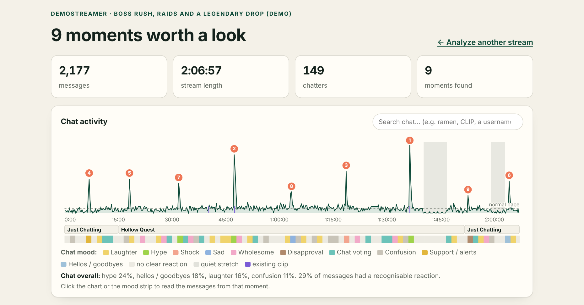
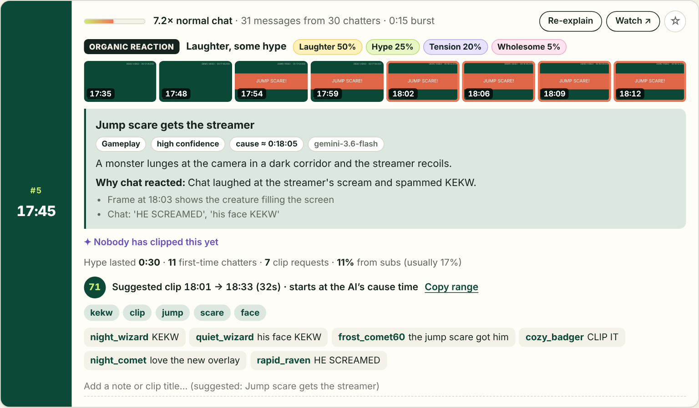
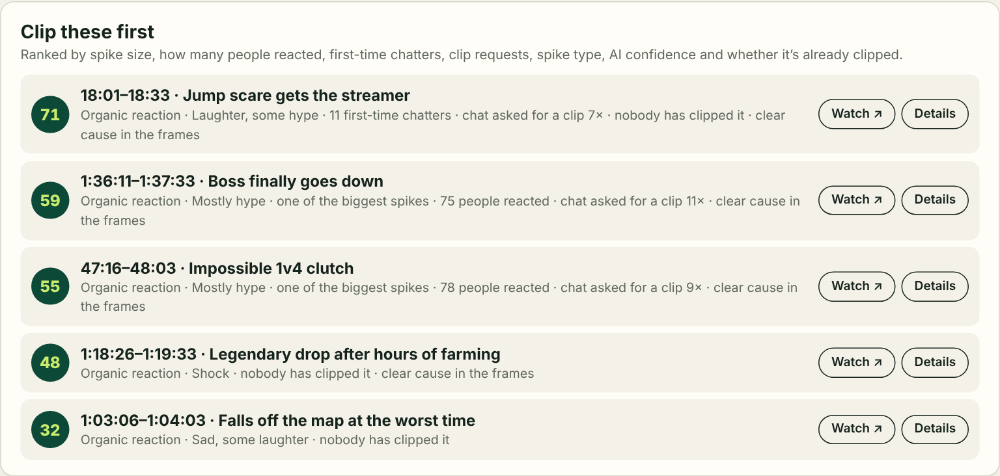
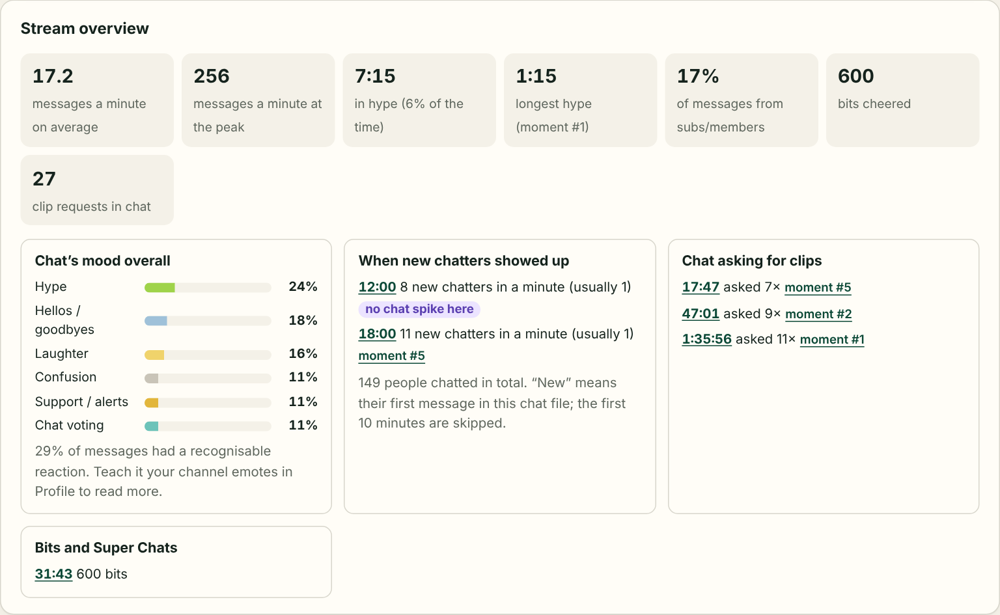

<div align="center">

# ◆ Viewtopsy

**Find the moments your chat loved, and learn why.**

Drop in a Twitch or YouTube VOD's chat replay. Viewtopsy finds where chat went wild, works out what kind of reaction it was and what caused it, shows where chat went quiet, and hands you clip-ready ranges for your editor.

[](https://github.com/Shreyas3303/viewtopsy/actions/workflows/tests.yml)

</div>

> **About the screenshots:** they use made-up demo data. The channel, usernames, video and clips are invented, and the AI explanation is a scripted example of what the feature returns, not real model output.

---

## Features

### Find the moments, see the whole stream



The chart shows chat activity across the whole VOD, with every spike ranked and numbered. Underneath, the **story strip** shows the VOD's chapters (game or category changes) and **chat's mood over time**: laughter, hype, shock, tension, voting and more. Gray bands mark stretches where chat went quiet, and purple ticks mark clips viewers already made.

- **Click to read:** click any point on the chart, a stretch of the mood strip, or a chapter to read its messages.
- **Search:** search chat for a word or username, and every match is marked on the chart.

### Every moment, explained



Each moment shows:
- **Spike type:** organic reaction, prompted (chat voting or answering), alert-driven, copypasta, or hellos/goodbyes.
- **Reaction mix,** read from emotes and chat slang (KEKW, monkaS, Pog, W/L, LMAOOOO, and your channel's own emotes).
- **Frames from your video:** taken from the seconds before chat started rising, where the cause usually is. The video is read in your browser and never uploaded.
- **An AI explanation (optional):** what happened, why chat reacted, the likely trigger, an estimated cause time and a confidence level. It works with a free Google Gemini key, or Claude.
- **Signals:** how long the hype lasted, first-time chatters, clip requests, subscriber share, bits and Super Chats.
- **A suggested clip range** you can copy, plus whether anyone has clipped it yet, a **Watch** link into the VOD, a star and a note.

### Clip these first



Every moment gets a **0–100 clip score** that weighs:
- spike size and how many people reacted
- first-time chatters and chat asking for a clip
- spike type (organic reactions rank above polls and alerts)
- the AI's confidence
- whether it's already clipped

The best five form a shortlist with the reasons behind each score. Connect Twitch (beta) and the VOD's existing clips are fetched automatically, so moments nobody has clipped yet stand out.

### The stream at a glance



The **Stream overview** covers the whole stream:
- messages a minute (average and peak)
- time spent in hype and the longest hype
- the mood mix
- **when waves of new chatters arrived**, including waves with no chat spike, such as a raid
- **every time chat asked for a clip**, including the times it did without a spike
- subscriber share, bits and Super Chats

### And also

- **Where chat went quiet:** stretches of 3+ minutes well below normal pace, with frames and an optional AI read on what happened and what to do about it.
- **Exports:**
  - YouTube chapters, CSV and JSON
  - **DaVinci Resolve (.edl)** and **Premiere Pro (.xml)** markers spanning each suggested clip range, aligned to your video file
- **Profile tab:** set your AI key, channel description (given to the AI as background), channel emote meanings and defaults once. They're saved in your browser.
- **Private by default:** chat files and videos never leave your computer. Only moments you choose to explain are sent to the AI provider you picked.

---

## Quick start

1. Download or clone this repo.
2. Open **`frontend/index.html`** in Chrome, Edge or Firefox.
3. Click **Try it with a sample stream**.

No install, account or server needed. To use **Connect with Twitch (beta)**, open it through the local server instead:

```bash
npm run serve        # then open http://localhost:8000
# no Node? this works too:
python -m http.server 8000 --directory frontend
```

## Getting a chat replay

| Source | How |
| --- | --- |
| **Twitch** | [TwitchDownloader](https://github.com/lay295/TwitchDownloader) → *Chat Download* → JSON. Trimmed downloads keep the full VOD's timestamps, and Viewtopsy lines a trimmed video up automatically. |
| **YouTube** | [yt-dlp](https://github.com/yt-dlp/yt-dlp): `yt-dlp --write-subs --sub-langs live_chat "<stream link>"` |
| **Either** | [chat-downloader](https://github.com/xenova/chat-downloader) JSON |
| **Anything else** | CSV or JSON with `timestamp`, `message` and optional `author`, `subscriber`, `bits` |

## AI explanations

AI explanations are optional and use your own API key, entered once in **Profile**:
- **Google Gemini (free tier):** get a key at [Google AI Studio](https://aistudio.google.com/apikey). Viewtopsy picks the best Flash model your key can use. Google may use free-tier requests to improve its products.
- **Anthropic Claude:** a `sk-ant-…` key works too.

The model can't hear audio yet, so moments caused by something the streamer said come back with low confidence instead of a guess.

## Connect with Twitch (beta)

Optional. It fetches a Twitch VOD's existing clips automatically for the clip comparison.
1. Run `npm run serve` and open `http://localhost:8000`.
2. Create a free app at [dev.twitch.tv/console/apps](https://dev.twitch.tv/console/apps) (client type: Public). Set its OAuth Redirect URL to the one shown in Profile.
3. Paste the app's Client ID into Profile and click **Connect with Twitch**.

No client secret or extra permissions are needed, and the token stays in your browser.

## How detection works

1. Chat is counted in short windows (15 seconds by default) and compared with the stream's normal pace.
2. Windows well above normal become moments, and back-to-back windows merge into one.
3. Viewtopsy finds where chat *started rising* before each peak, and anchors frames and clip ranges there, since the cause comes before chat's busiest moment.

A chat spike usually means something happened, but not always, so give each moment a quick watch before clipping.

## Python command-line tool

The same detection is available from the command line, plus helpers for fetching chat, clips and video:

```bash
pip install -e ".[dev]"
stream-moments analyze --chat data/chat/example.json        # JSON + Markdown reports in ./reports
stream-moments fetch-clips --id <VOD>                       # needs Twitch API keys in .env
```

See `.env.example` for keys and `stream-moments --help` for all commands.

## Development

```bash
npm test             # JavaScript tests (Node 18+)
python -m pytest     # Python tests, including a check that the web app and CLI agree
npm run serve        # Serve the app at http://localhost:8000
```

- `frontend/` is the web app (no build step).
- `src/stream_moments/` is the Python package.
- `tests/` has both test suites.
- `scripts/screenshots/make_screenshots.py` regenerates the README images from made-up demo data (fake chat, a generated demo video, invented clips and scripted AI replies).
